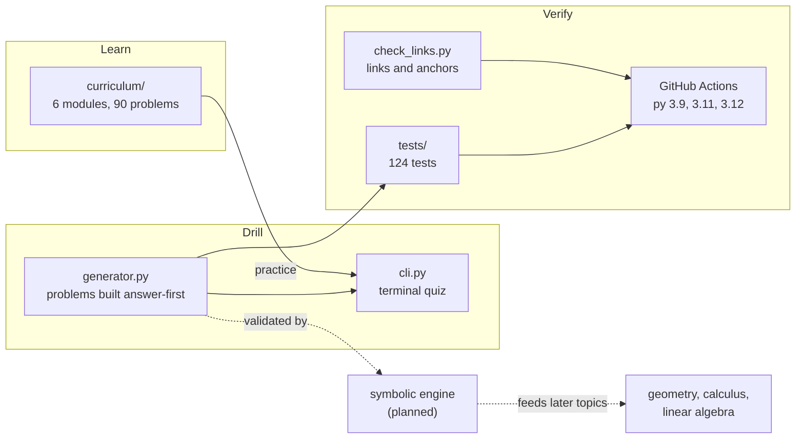
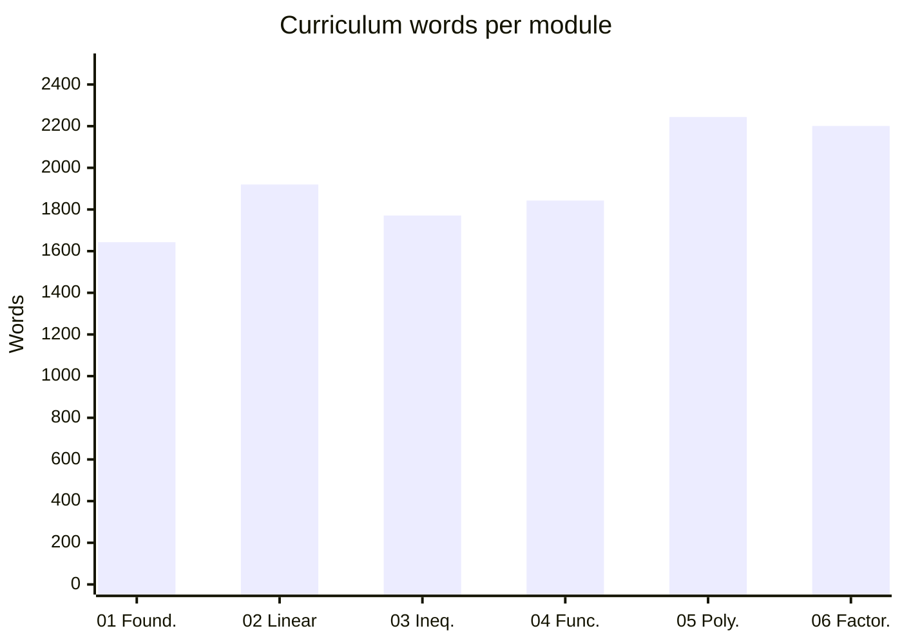
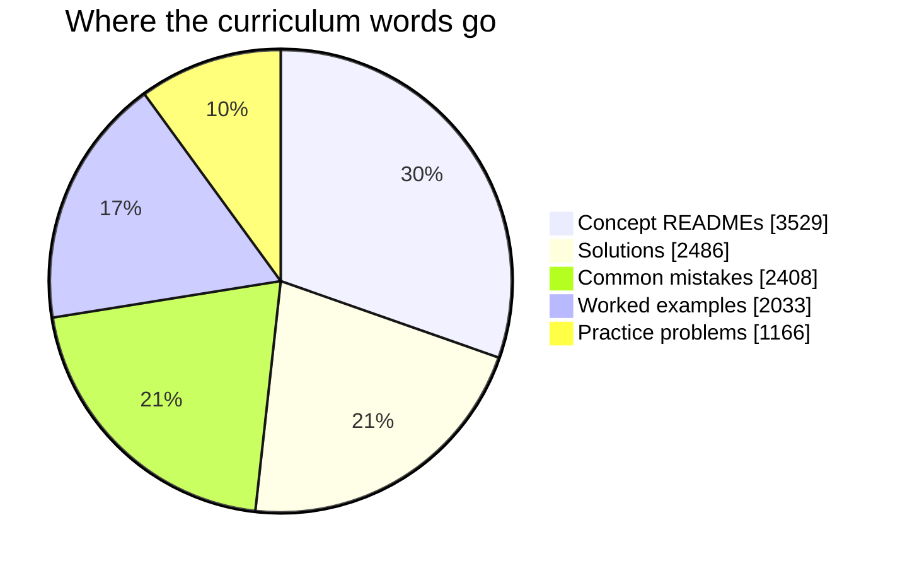
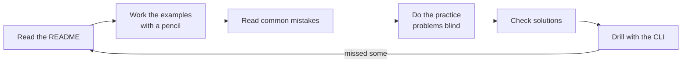
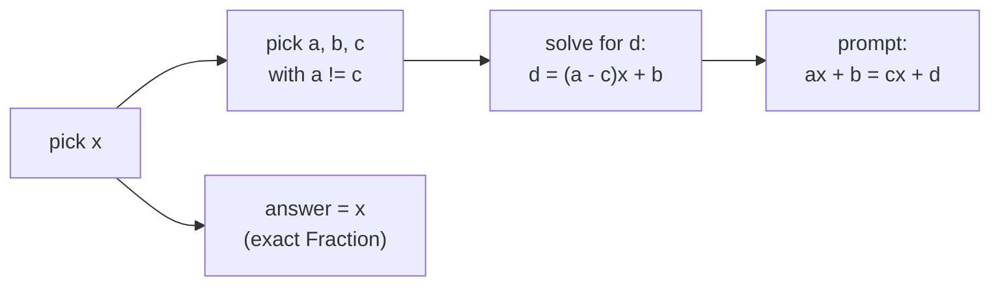
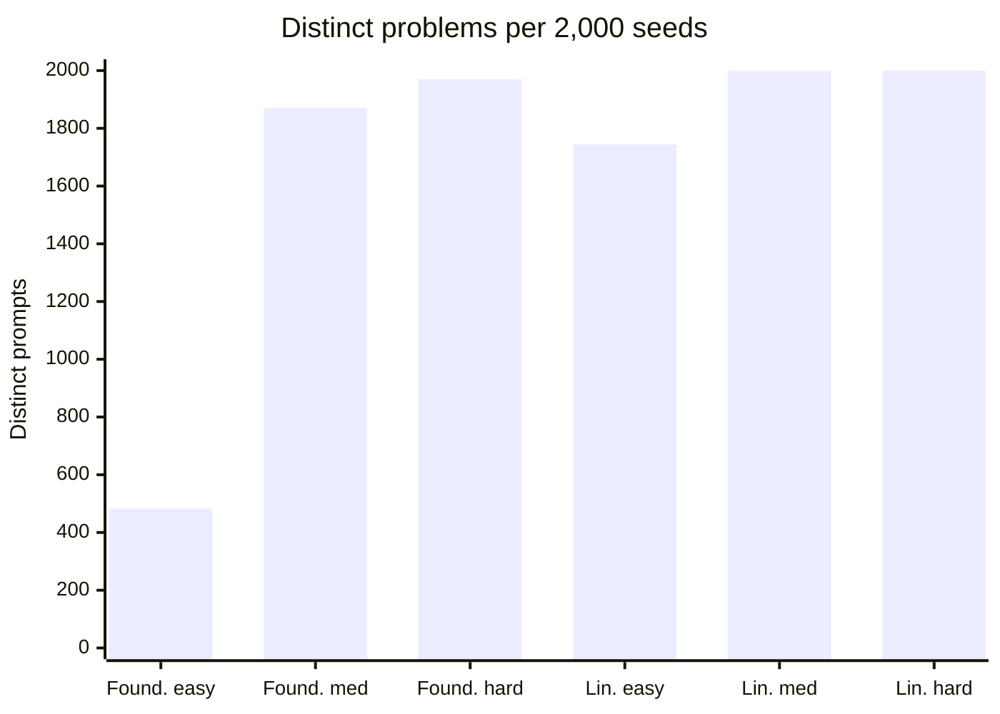
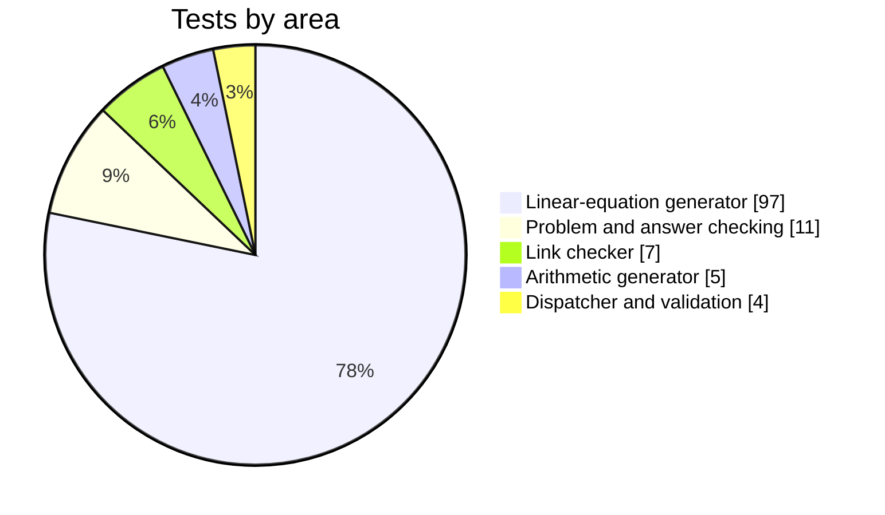
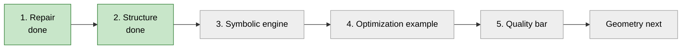

# ALGEBRA-

[](https://github.com/yashvardhansingh442-dev/ALGEBRA-/actions/workflows/ci.yml)


A free algebra curriculum, a practice generator with **exact** answer checking, and (in progress) a from-scratch exact-math engine. It is the first module of a larger long-term project, and every later math topic is meant to build on it.

> **Status:** early stage. The curriculum (modules 01-06), the practice generator for two topics, and the link checker are done and tested. The symbolic engine is **planned, not built yet**. See the [Roadmap](#roadmap) and [Known limits](#known-limits).

## Contents

- [At a glance](#at-a-glance)
- [How the pieces fit together](#how-the-pieces-fit-together)
- [Quick start](#quick-start)
- [Repo layout](#repo-layout)
- [Curriculum](#curriculum)
- [Practice tools](#practice-tools)
- [Generator statistics](#generator-statistics)
- [Tests and CI](#tests-and-ci)
- [Design rules](#design-rules)
- [Roadmap](#roadmap)
- [Known limits](#known-limits)
- [Contributing](#contributing)
- [License](#license)

## At a glance

| Metric | Value |
|---|---|
| Curriculum modules | 6 (foundations to factoring) |
| Curriculum text | about 11,600 words across 30 files |
| Worked examples | 30 (5 per module) |
| Practice problems with full solutions | 90 (15 per module: 5 easy, 5 medium, 5 hard) |
| Generator topics | 2 of 6 (foundations, linear equations) |
| Python source | 412 lines across 4 files (generator 282, link checker 69, CLI 57, entry point 4) |
| Tests | 124 (117 generator, 7 link checker) |
| Runtime dependencies | 0 (standard library only) |
| Static checks | `ruff` and `mypy --strict` |

| Part | What it is | Status |
|---|---|---|
| Curriculum | Six plain-language modules, five files each | Written, being refined |
| Generator and CLI | Random problems with step-by-step working and exact checking | Done for 2 topics |
| Link checker | Verifies every relative Markdown link and `#anchor` | Done, runs in CI |
| Symbolic engine | Expand, factor and solve exactly, with no SymPy | Planned |
| Optimization example | A constrained problem solved with the engine | Planned |

## How the pieces fit together



Solid arrows exist today. Dashed arrows are planned.

## Quick start

Needs Python 3.9 or newer.

```bash
git clone https://github.com/yashvardhansingh442-dev/ALGEBRA-.git
cd ALGEBRA-
pip install -e ".[dev]"      # installs the package, the `algebra` command, pytest, ruff, mypy
algebra --topic linear-equations --difficulty medium --count 5
python -m pytest -q
```

To quiz yourself without installing, run `PYTHONPATH=src python -m algebra_tools` from the repo root.

## Repo layout

```
ALGEBRA-/
├── curriculum/              the written course, one folder per module
│   ├── 01-foundations/
│   ├── 02-linear-equations/
│   ├── 03-inequalities/
│   ├── 04-functions/
│   ├── 05-polynomials/
│   └── 06-factoring/
├── src/
│   └── algebra_tools/       importable package
│       ├── generator.py     problem generation and exact answer checking
│       ├── cli.py           terminal quiz
│       └── __main__.py      enables `python -m algebra_tools`
├── scripts/
│   └── check_links.py       Markdown link checker
├── tests/                   pytest suite
├── docs/
│   └── generator.md         library usage and how to add a topic
├── .github/workflows/
│   └── ci.yml               lint, type check, tests, link check
├── pyproject.toml
├── CONTRIBUTING.md
└── LICENSE
```

## Curriculum

Each module has the same five files:

| File | Purpose |
|---|---|
| `README.md` | The concept, explained in plain language |
| `worked-examples.md` | 5 fully worked examples |
| `practice-problems.md` | 15 problems, easy to hard |
| `solutions.md` | Step-by-step solutions for all 15 |
| `common-mistakes.md` | The errors learners actually make, and why |

| # | Module | You learn | Words |
|---|---|---|---|
| 01 | [Foundations](curriculum/01-foundations/README.md) | Negative numbers, order of operations, what a variable is | 1,643 |
| 02 | [Linear Equations](curriculum/02-linear-equations/README.md) | Isolating x, variables on both sides, special cases | 1,920 |
| 03 | [Inequalities](curriculum/03-inequalities/README.md) | The sign-flip rule, number lines, compound inequalities | 1,771 |
| 04 | [Functions](curriculum/04-functions/README.md) | `f(x)` notation, domain, range, composition preview | 1,843 |
| 05 | [Polynomials](curriculum/05-polynomials/README.md) | Degree, adding, multiplying, FOIL | 2,244 |
| 06 | [Factoring](curriculum/06-factoring/README.md) | GCF, trinomials, difference of squares, a full checklist | 2,201 |



Later modules are longer: the course gets denser as the algebra gets harder.



**How to study a module**



## Practice tools

**Terminal quiz**

```bash
algebra --topic foundations --difficulty easy --count 5
# or, without the installed command:
python -m algebra_tools --topic foundations --difficulty easy --count 5
```

| Flag | Values | Default |
|---|---|---|
| `--topic` | `foundations`, `linear-equations` | `foundations` |
| `--difficulty` | `easy`, `medium`, `hard` | `easy` |
| `--count` | 1 or more | `5` |

Answers can be integers, decimals or fractions (`3/4`, `1 / 2`). Checking is exact: `0.33333` is not accepted for 1/3. Type `q` to quit; the score counts only the problems you attempted.

**As a library**

```python
from algebra_tools.generator import generate, Difficulty

problem = generate("linear-equations", difficulty=Difficulty.HARD, seed=42)
print(problem.prompt)           # the equation as text
print(problem.check("15"))      # True or False
print(problem.answer_display()) # "15", or a fraction like "-3/4"
print(problem.solution_text())  # step-by-step working
```

A `seed` makes output reproducible. The generator uses its own random instance and never touches your global random state. To add a topic, see [docs/generator.md](docs/generator.md).

**Why every problem is solvable**

Problems are built backwards. For a linear equation the generator picks the answer `x` first, then solves for the constants of `ax + b = cx + d`. The answer is known by construction, and `a` is forced to differ from `c` so the equation can never collapse to "no solution" or "infinitely many".



## Generator statistics

Measured by generating 2,000 problems per topic and difficulty (seeds 0 to 1999) and counting distinct prompts:

| Topic | Difficulty | Distinct prompts in 2,000 seeds |
|---|---|---|
| Foundations | easy | 482 |
| Foundations | medium | 1,871 |
| Foundations | hard | 1,970 |
| Linear equations | easy | 1,744 |
| Linear equations | medium | 1,999 |
| Linear equations | hard | 2,000 |



Foundations easy has the smallest pool (small number ranges and one operation pattern), so expect repeats in a long session. Every other combination gives close to a fresh problem each time.

## Tests and CI

```bash
python -m pytest -q              # generator and link-checker tests
python scripts/check_links.py    # every relative link and anchor in every .md file
ruff check .                     # lint
mypy                             # strict type check
```

| Test area | Tests |
|---|---|
| Linear-equation generator (round-trips across seeds and difficulties) | 97 |
| `Problem` and answer checking | 11 |
| Link checker | 7 |
| Arithmetic generator | 5 |
| Dispatcher and difficulty validation | 4 |
| **Total** | **124** |



[CI](.github/workflows/ci.yml) runs lint, type check, tests and the link check on every push and pull request, on Python 3.9, 3.11 and 3.12.

The link checker is also a test, so a broken link in any `.md` file fails the build.

## Design rules

1. **Standard library only at runtime.** Dev tools (pytest, ruff, mypy) are allowed; shipped code has no dependencies.
2. **Exact arithmetic.** Anything that is checked uses rational numbers (`Fraction`), never floats.
3. **Every feature ships with two tests:** one that proves it works and one that proves it rejects bad input.
4. **Smallest correct change.** Known limits are marked in the code as `shortcut: <limit>, <when to upgrade>`.
5. **Honest claims.** This is exact-math infrastructure for learning, not a general-purpose computer algebra system.

## Roadmap

| Phase | Work | Status |
|---|---|---|
| 1 | Repair the existing code and content | Done |
| 2 | Repo structure: `curriculum/`, `src/`, lowercase-hyphen names, CI at the repo root | Done |
| 3 | Symbolic package: parser, expansion, factoring over the rationals, exact linear systems | Not started |
| 4 | Optimization example: a constrained problem solved exactly with the engine | Not started |
| 5 | Quality bar: engine-validated generator problems, `ARCHITECTURE.md`, more modules | Not started |

Overall: 2 of 5 phases complete.



Planned engine features: parsing, expansion, factoring, exact linear and small nonlinear systems, and complex numbers. Planned content: modules 07-11 (rational expressions, exponents and radicals, quadratics, systems, word problems).

## Known limits

Stated plainly so nobody has to discover them:

- The generator covers 2 of the 6 modules. Inequalities, functions, polynomials and factoring have no generator yet.
- Float answers must equal the nearest double to the exact answer, so `0.3333333333333333` matches 1/3 but `0.33333` does not. This is deliberate and marked as a `shortcut` in `generator.py`.
- The CLI has no `--seed` flag, so a quiz session cannot be replayed. The library supports seeds.
- The link checker does not add the `-1` suffix GitHub uses for duplicate headings, so links to a second heading with the same name are not resolved correctly.
- There is no symbolic engine yet. Nothing in this repo can simplify or factor an expression it was not given a closed-form recipe for.
- Only the linear-equations solutions have been verified mechanically (every answer substituted back into its equation). The other five modules were checked by hand.

## Contributing

Read [CONTRIBUTING.md](CONTRIBUTING.md). Easy starts: fix a typo, verify a solution by re-solving it, add practice problems. In short: accuracy over speed, plain language first, follow the template, one concept per PR.

## License

[MIT](LICENSE), copyright 2026 Yash Vardhan Singh. This covers both the code and the written curriculum.
