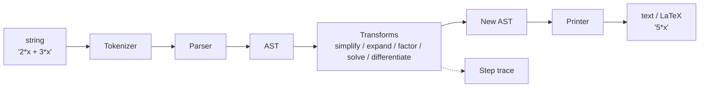

# Architecture

This document explains how **ALGEBRA-** is organized and why. Read it if you want to contribute code, add a topic, or understand how the symbolic engine works.

> **Status legend:** ✅ implemented · 🚧 in progress · 📋 planned
> Keep this legend up to date as phases land. A design doc that lies is worse than none.

---

## 1. Goals and non-goals

**Goals**

- Be a **learning resource**: a structured algebra curriculum anyone can follow with nothing but a browser.
- Be a **teaching tool**: the code does not just give answers, it shows the *steps*.
- Be a **from-scratch implementation**: the symbolic engine uses no SymPy or other CAS, so every algorithm is readable and explainable.
- Stay **small and legible**: a motivated learner should be able to read the whole engine in an afternoon.

**Non-goals**

- Competing with SymPy or Mathematica on coverage or speed.
- Supporting calculus beyond what the optimization material needs (derivatives of polynomials and simple functions).
- A GUI. The interface is the CLI plus importable Python.

---

## 2. Repository layout

```
ALGEBRA-/
├── curriculum/        # Learn: markdown lessons, practice, solutions
├── tools/             # Build: Python package + CLI
│   ├── cli.py
│   └── algebra_tools/
├── tests/             # Mirrors algebra_tools/
├── examples/          # Short runnable demos
├── docs/              # This file, roadmap, design notes, glossary
└── scripts/           # Repo maintenance (link checker, index builder)
```

The two halves are deliberately decoupled:

| Half | Needs Python? | Audience |
|------|---------------|----------|
| `curriculum/` | No | Learners |
| `tools/` | Yes | Practitioners, contributors |

They connect through **cross-links**: each lesson ends with a "Try it in code" pointer, and each example's docstring links back to its lesson.

---

## 3. The symbolic engine

The engine is a **pipeline of pure stages**. Each stage takes an input and returns a new output; no stage mutates shared state.



### 3.1 Stages

| Stage | Module | Input → Output | Status |
|-------|--------|----------------|--------|
| Tokenizer | `symbolic/tokenizer.py` | `str` → `list[Token]` | 📋 |
| Parser | `symbolic/parser.py` | tokens → AST | 📋 |
| AST | `symbolic/ast_nodes.py` | node definitions | 📋 |
| Simplify | `symbolic/simplify.py` | AST → AST | 📋 |
| Expand | `symbolic/expand.py` | AST → AST | 📋 |
| Factor | `symbolic/factor.py` | AST → AST | 📋 |
| Solve | `symbolic/solve.py` | equation AST → solutions | 📋 |
| Differentiate | `symbolic/differentiate.py` | AST → AST | 📋 |
| Printer | `symbolic/printer.py` | AST → text / LaTeX | 📋 |

### 3.2 The AST

Nodes are **immutable** (`@dataclass(frozen=True)`), so rewrite rules can never corrupt a tree that something else still references. Immutability also makes nodes hashable, which is handy for caching and for comparing expressions.

Node set (kept intentionally minimal):

| Node | Meaning | Example |
|------|---------|---------|
| `Num(value)` | Exact constant (uses `fractions.Fraction`, never float) | `3`, `1/2` |
| `Var(name)` | A symbol | `x` |
| `Add(terms)` | N-ary sum | `a + b + c` |
| `Mul(factors)` | N-ary product | `a * b * c` |
| `Pow(base, exp)` | Power | `x ** 2` |
| `Neg(operand)` | Unary minus | `-x` |
| `Func(name, arg)` | Named function | `sin(x)`, `ln(x)` |

Design choices:

- **N-ary `Add` and `Mul`**, not binary. `a + b + c` is one node with three children, which makes collecting like terms and sorting straightforward.
- **No `Sub` or `Div` nodes.** `a - b` is `Add(a, Neg(b))`; `a / b` is `Mul(a, Pow(b, Num(-1)))`. Fewer node types means fewer rewrite rules.
- **Exact arithmetic.** Constants are `Fraction`s so `1/3 + 1/3 + 1/3` is exactly `1`. Floats appear only in the `numeric/` package.

### 3.3 Parsing

Precedence climbing (Pratt-style) over the token stream. Grammar summary, lowest to highest precedence:

1. `+`, `-` (left-associative)
2. `*`, `/`, and **implicit multiplication** (`2x`, `3(x+1)`)
3. unary `-`
4. `^` / `**` (right-associative)
5. function calls, parentheses, atoms

Implicit multiplication is handled in the tokenizer/parser boundary and is the single trickiest part of parsing. It has its own test file section.

### 3.4 Normal form (canonical representation)

Simplification only works if "the same expression" has one shape. After `simplify`, an expression satisfies:

1. `Add` and `Mul` are flattened (no nested `Add` inside `Add`).
2. Constants are folded into a single `Num` placed first.
3. Like terms are combined (`x + 2*x` → `3*x`).
4. Terms and factors are sorted by a fixed ordering (degree descending for polynomials, then alphabetical by variable).
5. Identity elements are removed (`+ 0`, `* 1`, `** 1`), and annihilators are applied (`* 0` → `0`).

Rationale and open questions live in `docs/design/002-simplification-strategy.md`.

**Invariant:** `simplify(simplify(e)) == simplify(e)` (idempotence). This is enforced by a property test.

### 3.5 Step traces

Transforms return a result **and** a trace:

```python
@dataclass(frozen=True)
class Step:
    rule: str          # e.g. "combine like terms"
    before: Expr
    after: Expr

@dataclass(frozen=True)
class Result:
    value: Expr
    steps: tuple[Step, ...]
```

Every rewrite rule records a `Step` when it fires. `steps.py` renders traces as plain text or LaTeX. This is what turns the engine from a calculator into a teaching tool, and it is a **first-class requirement**, not a debugging aid: new transforms must emit steps.

---

## 4. Other packages

| Package | Purpose | Status |
|---------|---------|--------|
| `practice/generator.py` | Seeded, reproducible problem generation per topic | 📋 |
| `practice/difficulty.py` | Scores problems (number of steps, coefficient size, etc.) | 📋 |
| `practice/checker.py` | Checks a student answer by **equivalence**, not string match | 📋 |
| `numeric/newton.py` | Newton's method root finding | 📋 |
| `numeric/linear_system.py` | Gaussian elimination | 📋 |
| `optimization/lagrange.py` | Lagrange multipliers (builds on `differentiate` and `solve`) | 📋 |

**Answer checking by equivalence.** The checker parses the student's answer, then tests whether it equals the reference by (a) comparing normal forms, and (b) falling back to numeric evaluation at random sample points. So `x^2 - 1` and `(x-1)(x+1)` are both accepted.

**Seeded generation.** All generators take a `seed` so a problem set can be reproduced exactly (useful for tests and for sharing a worksheet).

---

## 5. The CLI

`tools/cli.py` is a thin wrapper. It parses arguments and calls into `algebra_tools`; it contains no algebra logic.

```
python -m tools.cli practice --topic quadratics --count 10 --seed 42
python -m tools.cli solve "x^2 - 5x + 6 = 0" --steps
python -m tools.cli simplify "2x + 3x - x"
python -m tools.cli check "x^2-1" --answer "(x-1)(x+1)"
```

Rule: anything the CLI can do must also be callable as a plain Python function. The CLI is a convenience, not the API.

---

## 6. Dependency policy

- **Runtime dependencies: as close to zero as possible.** The engine uses only the standard library (`dataclasses`, `fractions`, `typing`).
- **Dev dependencies** (`requirements-dev.txt`): `pytest`, `hypothesis`, `ruff`, `mypy`, `pre-commit`.
- **SymPy is not used in the package.** It *may* be used inside tests as an independent oracle to cross-check results, never imported from `algebra_tools`.

---

## 7. Testing strategy

Three layers, each catching a different kind of bug:

1. **Unit tests**: fixed inputs and expected outputs, one test file per module (`tests/test_parser.py`, etc.).
2. **Property tests** (Hypothesis), for example:
   - `simplify(simplify(e)) == simplify(e)` (idempotence)
   - `parse(print(e)) == e` (round trip)
   - `expand(factor(e))` is equivalent to `e`
3. **Numeric cross-check**: evaluate the original and the transformed expression at many random points; they must agree. This is the strongest guard against a wrong rewrite rule, because it tests *meaning* rather than shape.

Additional gates in CI:

- `ruff check` and `ruff format --check`
- `mypy --strict` on `tools/algebra_tools/`
- `pytest` with a coverage floor (start at 80%, raise over time)
- `scripts/check_links.py` for broken markdown links

---

## 8. Error handling

- **Parse errors** raise `ParseError` with the position of the offending token, so the CLI can point at it.
- **Unsupported operations** (for example, solving a degree-5 polynomial exactly) raise `NotSupportedError`, never return a silently wrong answer.
- **Domain errors** (division by zero, `ln(0)`) raise `DomainError`.
- Errors are specific exception types in `algebra_tools/errors.py`; the CLI catches them and prints a friendly message.

---

## 9. Extending the repo

**Add a curriculum topic**

1. Copy `curriculum/_templates/` into a new numbered folder under the right level.
2. Fill in `lesson.md`, `practice.md`, `solutions.md`, and `notes.md`.
3. Add the topic to `curriculum/00-start-here.md` (or run `scripts/build_index.py`).
4. Optionally add a generator in `practice/generator.py` and a test.

**Add a rewrite rule or transform**

1. Write the rule as a pure function `Expr -> Expr | None` (`None` means "does not apply").
2. Make it record a `Step`.
3. Register it in the relevant transform module.
4. Add unit tests, and confirm the property tests still pass.

---

## 10. Phased roadmap

| Phase | Scope | Status |
|-------|-------|--------|
| 1 | Repair existing content, fix README | 📋 |
| 2 | Restructure into `curriculum/`, `tools/`, `tests/`, CI | 📋 |
| 3 | Symbolic engine (tokenizer → parser → AST → simplify/expand/factor/solve) | 📋 |
| 4 | Lagrange-multiplier optimization example | 📋 |
| 5 | Tests, ruff, mypy strict, finalize this document | 📋 |

See `docs/ROADMAP.md` for detail.

---

## 11. Open questions

Track unresolved design decisions here and move them into `docs/design/` once settled.

- How far should `factor` go? (GCF, grouping, quadratics, rational roots theorem?)
- Should `solve` return a list, a set, or a structured result with multiplicity?
- LaTeX output: hand-rolled printer, or a minimal template layer?
- How to represent equations and inequalities (`Eq`, `Lt`, ...) alongside expressions?

---

## 12. Glossary

Algebra terms used in lessons are defined in [`docs/glossary.md`](glossary.md). Engine-specific terms:

- **AST**: abstract syntax tree; the structured form of an expression.
- **Normal form**: the single canonical shape `simplify` produces.
- **Rewrite rule**: a function that transforms an expression if a pattern matches.
- **Step trace**: the recorded list of rewrite rules applied to reach a result.
